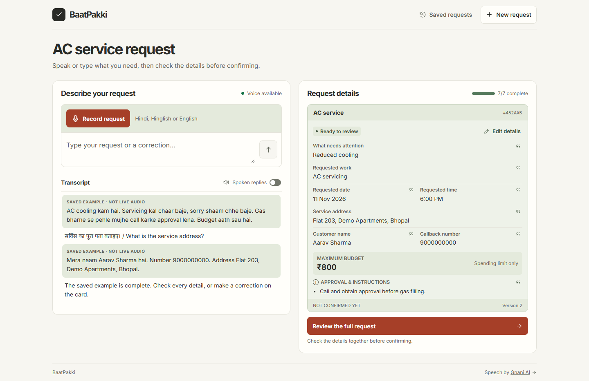

# BaatPakki

**Say it. Check it. Pakki.**

A Hindi/Hinglish voice intake workspace for an AC-service business. A customer speaks or types a request, corrects the extracted job card, reviews a complete readback and confirms that exact revision. A confirmed request still awaits the business's acceptance of the visit.

Uses **Gnani Prisma v3.0** for speech recognition and **Gnani Timbre v3.0 / Shivani** for spoken replies. A deliberately narrow, local parser maps supported request phrases to fields. **No Gemini or other text-model key is required.**

[One-page solution pitch](docs/SOLUTION_PITCH.md) · [Demo walkthrough](docs/DEMO.md)



## Run locally

Requires Node.js **24+** and npm.

```sh
npm ci
```

Copy `.env.example` to `.env`, then add your dashboard-generated `GNANI_API_KEY`. On PowerShell:

```powershell
Copy-Item .env.example .env
```

Do not overwrite an existing `.env`. This file is ignored by Git; never paste the key into source code, the browser, a demo, or an issue.

```sh
npm run dev
```

Open **http://127.0.0.1:4173**. For the production build:

```sh
npm run build
npm start
```

The application intentionally accepts only local/loopback traffic. Public hosting would require separate authentication, deployment configuration and abuse controls.

## Try a request

> AC cooling kam hai. Servicing kal chaar baje, sorry shaam chhe baje. Gas bharne se pehle mujhe call karke approval lena. Budget aath sau hai.

Then provide synthetic contact details, for example:

> Mera naam Aarav Sharma hai. Number 9000000000. Address Flat 203, Demo Apartments, Bhopal.

The time becomes 6 PM, the maximum budget is ₹800, and the approval instruction stays on the card. Review the written details or listen to the readback, then confirm. A correction such as `Haan lekin 7 PM ko aana` resets confirmation and changes the time. Direct edits do the same.

To try the flow without a Gnani key, select **Try a saved example**, **Add example contact details**, and **Review the full request**. The example uses synthetic details and its transcript is labelled as a saved example. You can also type your own request, edit fields, confirm, and print the card without a key.

## Scope and limits

- Automatic extraction supports tested Hindi/Hinglish/English phrase families: common cooling/leak/noise/start problems, servicing/inspection/repair requests, explicit names/addresses/phone numbers, relative/ISO/weekday dates, AM/PM times, whole-rupee budgets and approval restrictions.
- Open questions are tracked separately and deduplicated. They survive unrelated edits; a clear answer resolves only the relevant question. Unsupported instructions require an explicit acknowledgement after checking the card.
- This is **not general language understanding**. Check every field. Unsupported phrases are surfaced for clarification/manual editing; recognition/extraction can still misinterpret speech.
- A bare time needs AM/PM. An explicit correction can retain the earlier period in the same utterance, and a follow-up such as “PM” qualifies one known clock. Multiple clock alternatives still require one complete time. The parser does not infer prices, calendar availability, diagnoses, or that low cooling requires gas filling.
- Customer confirmation is tied to the request ID and reviewed version. “Yes, but...” changes the draft and needs another review.
- Requests and transcripts are stored locally in `data/baatpakki.sqlite`. Saved cards are isolated by a same-site, HTTP-only browser-session cookie. Clearing browser cookies loses access through that browser to earlier saved cards; the local database is not automatically erased.
- Microphone audio stays in memory in the browser tab and goes to Gnani for transcription. It is not saved by our server. Reloading removes source audio playback, while stored transcripts remain.
- Recording is mono 16-bit PCM WAV, resampled to 16 kHz, stopped at 28 seconds to fit the current 30-second STT endpoint cap. Type or edit if microphone permission is denied; “Continue by typing” cancels a pending permission request.
- No payments, dispatch, real phone calls, voice cloning, WhatsApp or public deployment.

## Design reference

The request workspace uses Inter with Noto Sans Devanagari for Hindi. Ivory makes up the main surfaces, sage groups related controls and details, and terracotta identifies primary actions. The layout stacks on narrow screens and respects reduced-motion preferences.

[Earlier typography and motion exploration in Figma](https://www.figma.com/design/8Z9oVF7vetfMw1Fk8usNcB?node-id=2-2).

## Verification

```sh
npm test
npm run build
```

Tests cover parser evidence, corrections, restrictions, budget limits, ambiguity, versioned confirmation, local API isolation/persistence, WAV validation, and provider failure contracts. Tests use synthetic fixtures/stubbed provider responses and do not spend API credits.

A separate live check on 6 November 2026 successfully generated a short Hindi utterance with Timbre and transcribed its WAV audio with Prisma. This establishes a synthetic provider round trip, not broad recognition accuracy, physical microphone quality, or noisy-call performance.

## Submission materials

- [Implementation plan](docs/superpowers/plans/2026-11-06-baatpakki.md)
- [API research and dashboard notes](GNANI_API_NOTES.md)

Never publish `.env`, the local database or test audio containing personal information. Use synthetic customer data in the demo.
